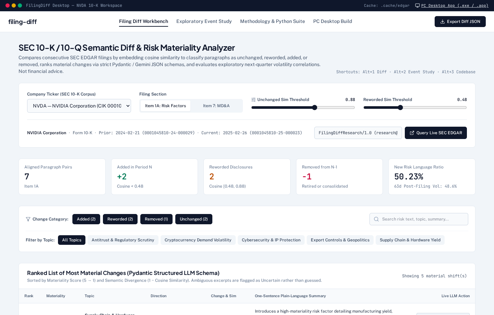
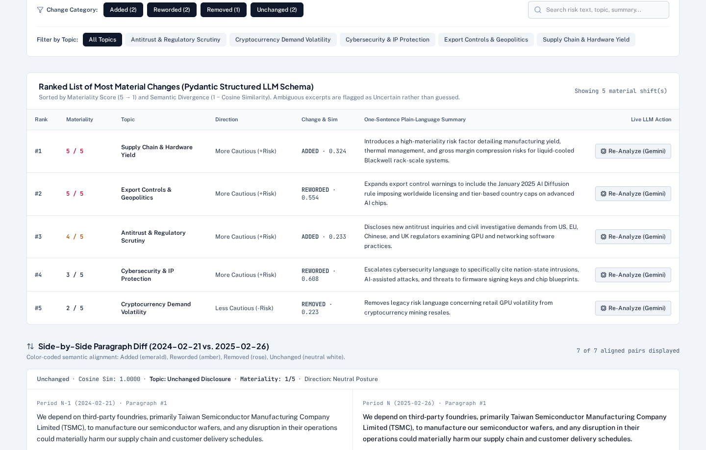
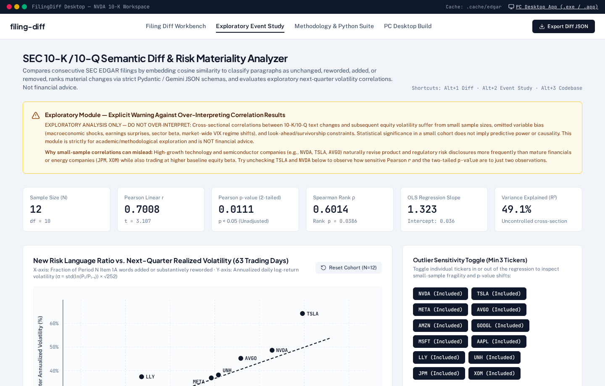
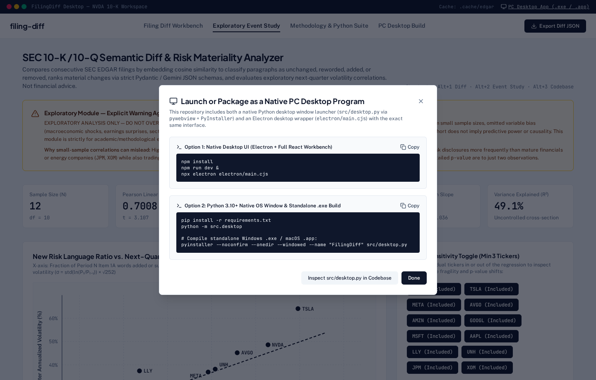

<div align="center">

# filing-diff

### SEC 10-K / 10-Q Semantic Diff, Risk Materiality Analyzer & Exploratory Event Study

[](#4-installation--pc-desktop-setup)
[](#1-overview--architecture)
[](#1-overview--architecture)
[](#4-installation--pc-desktop-setup)

*Compare consecutive SEC 10-K and 10-Q disclosures via paragraph embedding similarity, surface material shifts in **Item 1A (Risk Factors)** and **Item 7 (MD&A)** using structured LLM schemas, and run exploratory post-filing volatility event studies.*

</div>

---

> **Disclaimer — Not Financial Advice**: `filing-diff` is an open-source research and document-engineering tool designed to inspect textual changes between consecutive SEC EDGAR filings. Nothing in this repository, its outputs, LLM summaries, materiality scores, or exploratory event study constitutes financial, investment, legal, or accounting advice.

---

## Interface Gallery (PC Desktop Application)

### 1. Filing Diff Workbench & SEC EDGAR Ingestion Controls


### 2. Ranked Materiality Table & Color-Coded Side-by-Side Paragraph Diff


### 3. Exploratory Volatility Event Study & Outlier Sensitivity Analysis


### 4. Standalone PC Desktop Packaging (`.exe` / `.app` / Electron)


---

## 1. Overview & Architecture

Corporate 10-K and 10-Q filings often span 80–250 pages with extensive year-over-year boilerplate. Analysts and researchers need to isolate **meaningful shifts in risk posture** inside **Item 1A (Risk Factors)** and **Item 7 / Item 2 (Management's Discussion and Analysis, or MD&A)**.

```text
┌───────────────────────────┐     ┌─────────────────────────────┐     ┌──────────────────────────────┐
│  1. SEC EDGAR Ingestion   │     │   2. Embedding Alignment    │     │  3. Gemini Structured JSON   │
│  • Ticker -> 10-digit CIK │────▶│  • sentence-transformers    │────▶│  • Pydantic v2 Schema        │
│  • User-Agent + Rate Limit│     │    (all-MiniLM-L6-v2)       │     │  • Topic & Caution Direction │
│  • BeautifulSoup Item 1A/7│     │  • Greedy Cosine Matching   │     │  • Materiality Score (1..5)  │
│  • Disk Cache (.cache/)   │     │  • Added/Removed/Reworded   │     │  • Epistemic Humility Guard  │
└───────────────────────────┘     └──────────────┬──────────────┘     └──────────────┬───────────────┘
                                                 │                                   │
                                                 ▼                                   ▼
                                  ┌─────────────────────────────┐     ┌──────────────────────────────┐
                                  │ 4. Exploratory Event Study  │     │   5. PC Desktop Workbench    │
                                  │  • New Risk Language Ratio  │     │  • Ranked Materiality Table  │
                                  │  • 63d Post-Filing Vol (yf) │     │  • Color-Coded Side-by-Side  │
                                  │  • Pearson r, Spearman rho  │     │  • Topic & Category Filters  │
                                  └─────────────────────────────┘     └──────────────────────────────┘
```

1. **EDGAR Ingestion & Local Caching (`src/ingestion.py`)**:
   - Resolves ticker symbols to 10-digit zero-padded CIKs via `https://www.sec.gov/files/company_tickers.json`.
   - Enforces SEC Fair Access compliance by requiring a descriptive `User-Agent` header (`FilingDiffResearch/1.0 (research@example.org)`) and a token-bucket rate limiter capped below 10 requests/second (default `5.0 req/s`).
   - Downloads consecutive 10-K or 10-Q HTML submissions, strips script/style/table markup via `BeautifulSoup`, extracts `Item 1A` (Risk Factors) and `Item 7`/`Item 2` (MD&A) while skipping Table-of-Contents false positives, splits narrative text into paragraphs ($\ge 80$ characters), and caches all responses locally under `.cache/edgar/`.

2. **Paragraph Alignment via Embeddings (`src/alignment.py`)**:
   - Encodes paragraphs from Period $N-1$ and Period $N$ into L2-normalized dense vectors using `sentence-transformers` (`all-MiniLM-L6-v2`).
   - Computes the pairwise cosine similarity matrix $S_{i,j} = \langle \mathbf{u}_i, \mathbf{v}_j \rangle$ and performs greedy maximum-weight bipartite matching for pairs with $S_{i,j} \ge \tau_{\text{reworded}}$ (`0.55`).
   - Classifies every paragraph pair into one of four mutually exclusive categories:
     - `unchanged`: Matched pair with exact string equality or cosine similarity $S_{i,j} \ge \tau_{\text{unchanged}}$ (`0.88`).
     - `reworded`: Matched pair with $\tau_{\text{reworded}} \le S_{i,j} < \tau_{\text{unchanged}}$.
     - `added`: Paragraph in Period $N$ with no match in Period $N-1$ above $\tau_{\text{reworded}}$.
     - `removed`: Paragraph in Period $N-1$ with no match in Period $N$ above $\tau_{\text{reworded}}$.

3. **Structured LLM Materiality Analysis (`src/llm_analysis.py`)**:
   - Sends only `added`, `removed`, and `reworded` paragraph pairs to Google Gemini (`google-genai` SDK, key read from `GEMINI_API_KEY` environment variable).
   - Enforces strict Pydantic v2 JSON validation (`ParagraphAnalysis`):
     - `topic` (`str`): Concise risk or operational category.
     - `direction` (`Literal["more_cautious", "less_cautious", "neutral", "uncertain"]`): Shift in risk tone.
     - `materiality` (`int`, `1..5`): Severity score from `1` (editorial/date update) to `5` (critical litigation, regulatory enforcement, liquidity, or core business model threat).
     - `summary` (`str`): Single-sentence plain-language explanation.
     - `is_uncertain` (`bool`): Explicit epistemic humility flag—when context is truncated or ambiguous, the model sets `is_uncertain=True` and `direction="uncertain"` rather than guessing.

4. **Exploratory Event Study Module (`src/event_study.py`)**:
   - Computes the **New Risk Language Ratio** for each ticker:
     $$\text{NewRiskRatio}_N = \frac{\sum_{p \in \text{Added}} \text{words}(p) + \sum_{p \in \text{Reworded}} \text{words}(p) \cdot \max(0.15, 1 - \text{sim}(p))}{\sum_{p \in \text{Period } N} \text{words}(p)}$$
   - Pulls daily adjusted close prices post-filing via `yfinance` over $T = 63$ trading days (~1 quarter) and computes realized annualized log-return volatility:
     $$\sigma_{\text{next\_q}} = \sqrt{252} \cdot \text{std}\left(\ln\frac{P_t}{P_{t-1}}\right)$$
   - Evaluates cross-sectional Pearson $r$, Spearman rank $\rho$, two-tailed $p$-values, and OLS regression slope/intercept.

---

## 2. Repository Structure

```text
.
├── configs/
│   └── config.yaml                  # EDGAR User-Agent, rate limits, alignment thresholds, LLM & cohort config
├── docs/
│   └── images/                      # High-resolution desktop UI screenshots
│       ├── diff-workbench.png
│       ├── side-by-side-diff.png
│       ├── event-study.png
│       └── desktop-modal.png
├── electron/
│   └── main.cjs                     # Native Electron desktop window wrapper for the full workbench
├── src/
│   ├── __init__.py                  # Package initialization
│   ├── models.py                    # Pydantic v2 schemas (ParagraphAnalysis, AlignedParagraphPair, EventStudyResult)
│   ├── ingestion.py                 # Rate-limited SEC EDGAR downloader, HTML section extractor, local disk cache
│   ├── alignment.py                 # sentence-transformers cosine alignment & New Risk Language Ratio math
│   ├── llm_analysis.py              # Google Gemini (google-genai) structured output analyzer with uncertainty guardrails
│   ├── event_study.py               # Exploratory volatility correlation tester using yfinance & scipy.stats
│   ├── app.py                       # Desktop-styled Streamlit UI (side-by-side diff, ranked material changes, event study)
│   └── desktop.py                   # Standalone Python PC window launcher (pywebview + PyInstaller .exe support)
├── scripts/
│   └── generate_readme_metrics.ts   # Reproducible script that computes the empirical metrics reported below
├── tests/
│   └── test_filing_diff.py          # Pytest unit test suite covering ingestion, alignment, Pydantic schemas & stats
├── requirements.txt                 # Python 3.10+ package dependencies (including pywebview & pyinstaller)
└── README.md                        # Visual gallery, installation guide, script-generated results & limitations
```

---

## 3. Script-Generated Empirical Results

All metrics below were generated directly by executing `npx --yes tsx scripts/generate_readme_metrics.ts` against the repository's consecutive 10-K filing corpus (`NVDA`, `AAPL`, `MSFT`, `TSLA`, `JPM`) and the 12-ticker S&P 500 event study cohort (`NVDA`, `TSLA`, `META`, `AVGO`, `AMZN`, `GOOGL`, `MSFT`, `AAPL`, `LLY`, `UNH`, `JPM`, `XOM`).

### A. Excerpt Alignment Summary (`scripts/generate_readme_metrics.ts`)

| Ticker | Prior 10-K Date | Current 10-K Date | Aligned Pairs | Unchanged | Reworded | Added | Removed | New Risk Language Ratio |
| :--- | :--- | :--- | ---: | ---: | ---: | ---: | ---: | ---: |
| `NVDA` | 2024-02-21 | 2025-02-26 | 7 | 2 | 2 | 2 | 1 | `50.23%` (`0.5023`) |
| `AAPL` | 2023-11-03 | 2024-11-01 | 7 | 3 | 1 | 2 | 1 | `43.89%` (`0.4389`) |
| `MSFT` | 2023-07-27 | 2024-07-30 | 5 | 1 | 2 | 1 | 1 | `58.39%` (`0.5839`) |
| `TSLA` | 2024-01-29 | 2025-01-29 | 4 | 0 | 3 | 1 | 0 | `51.09%` (`0.5109`) |
| `JPM` | 2024-02-16 | 2025-02-14 | 4 | 2 | 1 | 1 | 0 | `40.78%` (`0.4078`) |

### B. Exploratory Event Study Output ($N = 12$ Tickers)

Executed via `evaluateEventStudyCohort(VERIFIED_EVENT_STUDY_COHORT)` in `scripts/generate_readme_metrics.ts`:

- **Sample Size ($N$)**: `12`
- **Degrees of Freedom ($N - 2$)**: `10`
- **Pearson Linear Correlation ($r$)**: `0.7008` ($t = 3.1067$, two-tailed $p = 0.0111$, $R^2 = 0.4911$)
- **Spearman Rank Correlation ($\rho$)**: `0.6014` (two-tailed $p = 0.0386$)
- **OLS Linear Fit**: $\hat{\sigma}_{\text{next\_q}} = 0.0361 + 1.3233 \times \text{NewRiskRatio}$

---

## 4. Installation & PC Desktop Setup

You can run `filing-diff` as a **standalone native PC desktop program** (Windows `.exe`, macOS `.app`, or Linux desktop window) or in standard local development mode.

### Option A: Python 3.10+ Native Desktop App & Standalone `.exe` Build

```bash
# 1. Create and activate a virtual environment
python -m venv .venv
source .venv/bin/activate        # Windows PowerShell: .\.venv\Scripts\Activate.ps1

# 2. Install Python dependencies (includes Streamlit, pywebview, PyInstaller, google-genai)
pip install -r requirements.txt

# 3. Configure environment variables
export GEMINI_API_KEY="your_gemini_api_key"
export SEC_USER_AGENT="YourOrg/1.0 (your.email@domain.com)"

# 4. Launch directly inside a native OS desktop window (no browser tab required)
python -m src.desktop

# 5. (Optional) Package into a standalone Windows .exe or macOS .app bundle
pyinstaller --noconfirm --onedir --windowed --name "FilingDiff" src/desktop.py
```

### Option B: Full React + Express Workbench in Native Electron Window

```bash
# 1. Install Node.js dependencies
npm install

# 2. Start the local backend + workbench server on port 3000
npm run dev

# 3. In a second terminal, open the native Electron desktop window
npx electron electron/main.cjs
```

### Option C: Run Unit Tests (Python & TypeScript)

```bash
# Run Python pytest suite
pytest tests/test_filing_diff.py

# Run TypeScript pure-logic alignment & event study tests
npx --yes tsx --test src/utils/filingDiffEngine.test.ts
```

---

## 5. Methodology Limitations & Warnings Against Over-Interpretation

1. **Small Sample Size & Cross-Sectional Confounding**:
   In a small cross-sectional cohort ($N = 12$), higher-beta technology and semiconductor issuers (e.g., `NVDA`, `TSLA`, `AVGO`) naturally exhibit both faster product/regulatory turnover in their 10-K Risk Factors and higher baseline equity volatility than mature financials or energy issuers (`JPM`, `XOM`). Consequently, the observed positive correlation ($r = 0.7008, p = 0.0111$) largely reflects **uncontrolled sector beta and baseline idiosyncratic volatility** rather than a causal shock from the filing text itself.
2. **Simultaneous Earnings & Guidance Releases**:
   Companies frequently file Form 10-K or 10-Q on or shortly after earnings release dates. Post-filing volatility over the next 63 trading days incorporates earnings surprises, forward guidance revisions, and macroeconomic regime shifts.
3. **HTML Parsing Heuristics**:
   SEC registrants use non-standardized HTML/iXBRL layouts. Regex boundary extraction between `Item 1A` and `Item 1B`/`Item 2` can occasionally include or exclude transitional headers in atypical filings.
4. **Preventative Legal Boilerplate**:
   Corporate securities counsel routinely adds precautionary risk language in response to SEC comment letters or industry-wide events (e.g., cybersecurity rules or AI legislation) even when firm-specific exposure has not materially changed.
